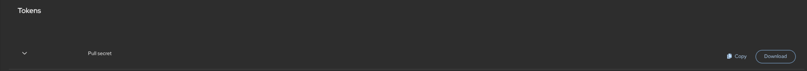

# Disconnected oc-mirror workflow 
### Purpose 
- To simplify and document the oc-mirror process for transferring data when there is no unlcass infrastructure available.

## Setup with Jorge before testing this
- Dedicate a singular drive to being the oc-mirror drive
- Create a layout inside of the drive as such: 
    - /mnt/oc-mirror
    - /mnt/oc-mirror/output
    - /mnt/oc-mirror/cache

### Setup and workflow
1. Ensure you have requested Removale Media Access for your device 
2. Make sure to have the drive plugged into your device
3. Download your pull-secret from console.redhat.com 
    - Navigate to https://console.redhat.com/openshift/downloads and at the bottom of the page you'll see a download button for the pull secret
    [
4. Install WSL on your Windows Laptop through software center 
5. Open a command prompt and type ```wsl```
6. Clone down this repo to the WSL image ```git clone <repo>.git```
7. Change directories to the cloned project
8. Place your downloaded pull-secret in the cloned project directory (preserve the pull-secret.txt name) 
9. Run the script to pull the operators down ```bash scripts/pull-operators.sh``` and follow the prompts 
10. Transfer the mirror tar to the airgapped environment 